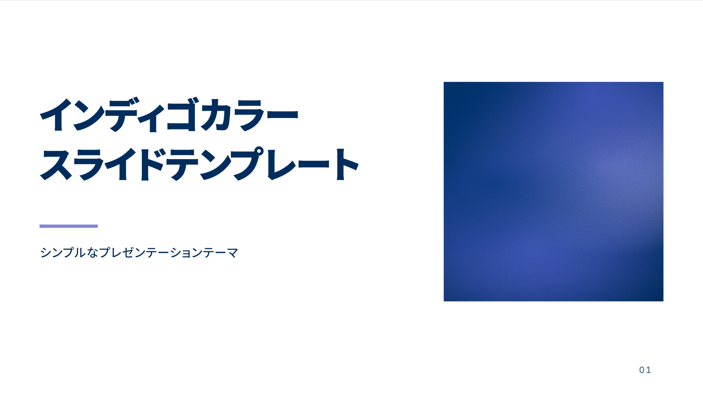

# Indigo Flow



## 使用方法

このリポジトリではルートで `bun install` を実行してから、次のheadmatterを指定します。

```yaml
---
theme: ./theme
lang: ja
themeConfig:
  footer: 発表タイトル / 発表者
---
```

テーマ既定値は16:9、キャンバス幅1280px、light、fadeです。背景は各レイアウトで定義しています。白地の本文と濃紺の表紙・章扉を一組として使用します。

別プロジェクトでは `theme/` をコピーし、そのディレクトリを依存として追加してから `theme: ./theme` を指定してください。例：`bun add ./theme`。テーマ内の `package.json` にフォント依存を含めています。npmへの公開はしていません。

## レイアウト

| layout       | 用途                       | 名前付きスロット / 主な設定                            |
| ------------ | -------------------------- | ------------------------------------------------------ |
| `cover`      | 表紙。先頭ページの既定     | `seed` でメッシュ模様を指定。`palette: false` で非表示 |
| `default`    | 通常の本文、パレット、表   | `::note::`                                             |
| `section`    | 章扉                       | `number: '01'`                                         |
| `three-cols` | 番号付きの3カラム          | `::left::` / `::middle::` / `::right::` / `::note::`   |
| `data`       | 比較図と強調する数値       | `::chart::` / `::metric::` / `::note::`                |
| `split`      | コードと説明などの左右分割 | `::left::` / `::right::` / `::note::`                  |
| `intro`      | 色帯のない表紙             | 共通設定                                               |
| `fact`       | 大きな数値                 | 通常スロット                                           |
| `statement`  | 大きな一文                 | 通常スロット                                           |
| `quote`      | 引用                       | 通常スロット                                           |

表紙の右側は8色のパレットを混ぜたメッシュグラデーションです。frontmatterの `seed` に数値または空でない文字列を指定します。既定値は `42`。同じシードなら再読み込み・ビルド・書き出しでも同じ模様になります。

```yaml
---
layout: cover
seed: indigo-flow
---
```

共通のfrontmatter：

- `eyebrow`：上部の小さなラベル。指定しない場合は表示しません。
- `footer`：そのページのフッター。全体の `themeConfig.footer` より優先。`false` で非表示。
- `pageNumber: false`：そのページの番号を非表示。

見出しは通常スロットに `# 見出し` として記述します。`split`、`three-cols`、`data` の通常スロットは全幅のヘッダーです。各領域は名前付きスロットへ記述してください。`::note::` はスライド上に表示する注記で、Slidevの発表者ノートとは別です。

```md
---
layout: three-cols
---

# 3つの要点

::left::

## 結論

最も伝えたい内容。

::middle::

## 根拠

結論を支える情報。

::right::

## 次の一歩

具体的な行動。

::note::

補足や出典。
```

## コンポーネント

`IndigoPalette` は8色とCSS変数名を表示します。`bars` 属性でラベルのない縦帯になります。

```html
<IndigoPalette />
```

`IndigoMeshGradient` は装飾用のメッシュグラデーションです。`seed` で色の配置と広がりを変えます。色は `--color-1` 〜 `--color-8` に追従します。SVGの `feTurbulence` で生成したモノクロのgrainをoverlayで重ねています。grainの濃さは `styles/components.css` の `.indigo-mesh-gradient::after` にある `opacity`（既定値 `0.4`）で調整できます。空文字列・非数・無限大などの不正なシードはエラーにします。

```html
<IndigoMeshGradient :seed="42" /> <IndigoMeshGradient seed="indigo-flow" />
```

`IndigoBarChart` は比較用の横棒グラフ。各項目の `color` は1〜8、`max` の既定値は100、`unit` は `%` です。値を自動補正せず、範囲外・非数・不正な最大値はエラーにします。

```html
<IndigoBarChart
  title="指標ごとの比較"
  :items="[
    { label: 'A案', value: 72, color: 4 },
    { label: 'B案', value: 58, color: 6 },
    { label: 'C案', value: 35, color: 8 },
  ]"
/>
```

`IndigoMetric` は `data` レイアウトの `::metric::` に置きます。

```html
<IndigoMetric value="72%" label="KEY MESSAGE">
  最も伝えたい数値を<br />大きく、明快に。
</IndigoMetric>
```

`IndigoPoint` は任意の領域で利用できる番号付きパネル。`index="01"`、`:accent="6"` を指定し、内容には `## 見出し` と本文を置きます。

## カラーと書体

`styles/tokens.css` の `--color-1` 〜 `--color-8` に指定のOKLCH値をそのまま定義しています。背景の淡色・罫線・補助テキストは、このパレットと白の `color-mix()` で作ります。小さな本文は濃色で表示し、明るい色は面やラインなどに使います。

本文・ラベル・番号・数値はGen Interface JP、見出しは同ファミリーのDisplay。Geist Monoはコードブロック、インラインコード、CSS変数名に限定しています。

- [Gen Interface JP](https://github.com/yamatoiizuka/gen-interface-jp)：`gen-interface-jp@0.8.0`。本文400 / 500 / 600 / 700、Display 800。フォントはSIL Open Font License 1.1。
- [Geist](https://github.com/vercel/geist-font)：`@fontsource-variable/geist-mono@5.3.0` の通常体の可変フォント。SIL Open Font License 1.1。

npmパッケージの相対WOFF2参照をViteでバンドルします。自動Webフォント取得とフォントの代替列は無効にしています。見出し以外に合成太字や合成斜体は使用しません。Geist MonoのLatinセットにない文字をコードに入れる場合は、その文字の表示方法を別途指定してください。

## コンテンツの目安

参照の余白を保つため、通常見出しは1行、表紙・章扉は2行、3カラムは見出し1行と本文2〜4行を目安にしてください。長い内容はスライドを分けます。自動縮小や自動的なレイアウト変更は行いません。HTMLで `class="lead"` を指定すると補助色の導入文になります。

## 開発・ライセンス

ルートで `bun run dev` / `bun run build` / `bun run export` を実行します。テーマ単体の例は `theme/example.md`、全レイアウトの主な使用例はルートの `slides.md` です。

テーマのコードはMIT。元のSlidevテーマに由来するライセンス表記は `LICENSE` に保持しています。フォントのライセンスは各依存パッケージに同梱されています。
