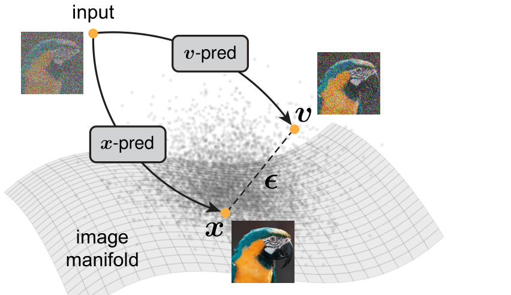
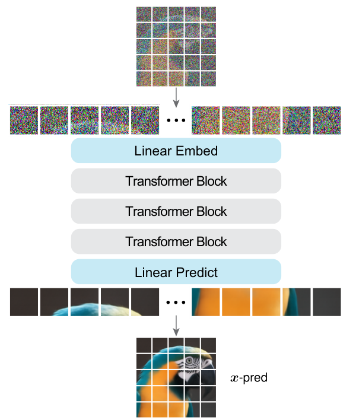
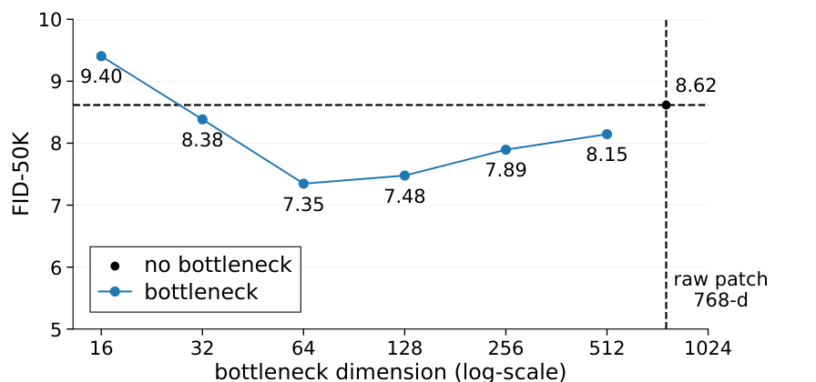
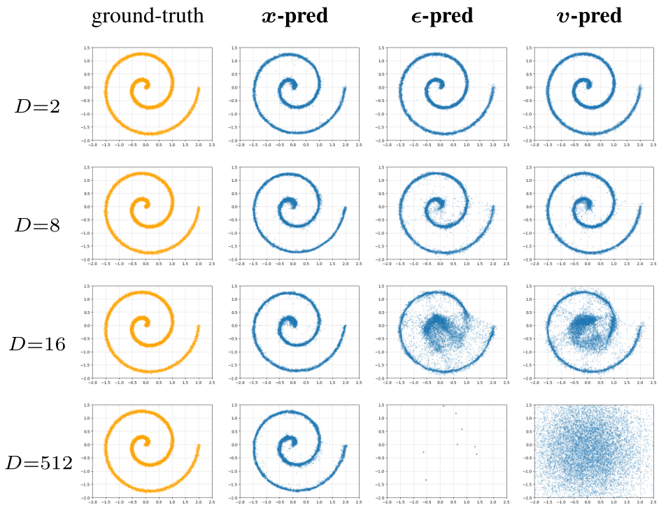

# JiT

<div class="jit-cover-subtitle">ピクセル空間の拡散モデルを<br>画像予測へ戻す</div>

<div class="jit-cover-paper">Back to Basics: Let Denoising Generative Models Denoise<br>Tianhong Li · Kaiming He / MIT / 2025</div>

<div class="jit-cover-meta">日本語 · 大学院生向け · 15分 / 質疑別枠<br>原論文 v2（2026-01-07）＋公式PyTorch実装</div>

<!--
構成表：本編01–15は計900秒。16–18は質疑用で時間外。
聴衆：拡散モデルとTransformerの基礎知識がある大学院生。目的：理解と批判的検討。
番号 | 結論・問い | 主図・表 | 根拠 | 秒
01 | ピクセル空間の拡散モデルを画像予測へ戻す | 表紙 | 書誌・§1 | 30
02 | JiTはピクセルから直接画像を生成する | Fig.5 | §1,5 | 45
03 | 大きなパッチは情報の圧縮を迫る | 次元の表 | §2,4.1, Table 5 | 65
04 | 著者の仮説：画像の構造だけを残せばよい | Fig.1 | §1,3.3 | 60
05 | 画像パッチをTransformerで処理する | Fig.3 | §4.1 | 75
06 | 画像を予測し速度の誤差で学習する | Eq.1,2,6 | §3.2,4.3 | 90
07 | 画像予測を速度へ変換して進む | ODE更新式 | §3.1, Alg.2, App.A | 55
08 | 高次元では予測対象の違いが決定的になる | Table 2(a,b) | §4.2 | 80
09 | 128次元へ圧縮しても生成が成立する | Fig.4 | §4.2 | 60
10 | 汎用的なTransformerの改良も有効 | Table 4 | §4.4 | 40
11 | 高解像度でも系列長を保てる | Table 5 | §5, App.A | 65
12 | モデル規模と学習の拡大でFIDは改善する | Table 6 | §5, App.A | 50
13 | 単純な構造と計算量に強みがある | Table 8 | §5 | 55
14 | 結果の一般化には検証が必要 | 限界の整理 | §6, App.A | 65
15 | 予測対象をデータの構造に合わせる | まとめ | §1,4–6 | 65
16 | 公式実装の画像予測と速度損失 | コード | denoiser.py | 質疑
17 | 低次元構造を高次元へ埋め込む実験 | Fig.2 | §3.3 | 質疑
18 | 原論文・実装・図の出典 | 文献 | 一次資料 | 質疑

Slide 01
目的：論文と発表の前提を示す。
問い：何を扱い、何を理解できる発表か。
画面構成：左に研究名と主題、右にテーマ既存のメッシュ。
図：テーマの装飾。科学的内容を示す図ではない。
出典：https://arxiv.org/abs/2511.13720v2 ; https://github.com/LTH14/JiT
発表ノート：JiTはJust image Transformerの略。中心の問いは、有限容量のネットワークに何を直接予測させるか。2025年の技術報告で、2026年1月7日改訂のv2を用いる。論文報告値とPyTorch版の処理を紹介し、一般化の範囲を議論する。
時間：30秒。
-->

---
eyebrow: '01 / 問題設定'
---

# JiTはピクセルから直接画像を生成する

<div class="jit-columns jit-preview">
<div>
<p class="jit-lead">ノイズとクラスラベルを入力し、<br><strong>RGB画像を直接生成</strong>する</p>

- 事前学習したVAEを使わない
- 画像生成の学習は追加損失なし
- 大きなパッチを使うTransformer

<p class="jit-aside">問い：画像を圧縮する外部モデルに頼らず、<br>高解像度の生成を成立させられるか？</p>
</div>
<figure>

<figcaption>JiT-H/32 · ImageNet 512×512<br>著者が選んだ生成例（無作為標本ではない）</figcaption>
</figure>
</div>

::note::

Li & He, [arXiv v2](https://arxiv.org/abs/2511.13720v2), §1・§5, Fig.5（p.8）より転載。VAE＝変分オートエンコーダ。

<!--
Slide 02
目的：入力・出力と研究課題を具体化する。
問い：何を生成するモデルで、なぜ必要なのか。
画面構成：左に課題、右にFig.5全30例。
図：Fig.5の画像領域を転載。著者による選択例であることを明記。
出典：v2 §1, §5, Fig.5, p.8。
発表ノート：ImageNetのクラス条件付き生成を扱う。潜在拡散が使う学習済み潜在空間を介さず、RGB上で学習する。追加損失なしは主要実験の条件。付録B.3には分類損失を加えた別の探索実験もある。画像例は品質の直感を与えるが、定量評価の代わりにはならない。
時間：45秒。
-->

---
eyebrow: '01 / 問題設定'
---

# 大きなパッチは、情報の圧縮を迫る

<p class="jit-lead">パッチ＝画像を分割した領域。1パッチを1個のトークンとして処理する</p>

| 画像の解像度 | パッチ | 1パッチのRGB次元 | 画像トークン数 | JiT-Bの隠れ次元 |
| :--- | :--- | ---: | ---: | ---: |
| 256×256 | 16×16 | 768 | 256 | 768 |
| 512×512 | 32×32 | **3,072** | 256 | 768 |
| 1024×1024 | 64×64 | **12,288** | 256 | 768 |

<div class="jit-takeaway">系列長は抑えられる。しかし、各トークンに入る情報は増える</div>


::note::

Li & He, [arXiv v2](https://arxiv.org/html/2511.13720v2#S4.SS1), §2・§4.1, Table 5（p.7）を基に再構成。トークン数は画像パッチのみ。

<!--
Slide 03
目的：大きなパッチの利点と容量上の課題を説明する。
問い：ピクセルを直接Transformerに入れると何が難しいか。
画面構成：全幅の表、増えるパッチ次元を太字で示す。
図：§4.1とTable 5に基づく表。
出典：v2 §2, §4.1, Table 5, pp.2–3,5,7。
発表ノート：RGB次元はパッチ幅の二乗×3。系列長は画像の縦横をパッチ幅で割った積。512画像に32パッチなら256トークンに保てるが、1トークンには3072個の値が入る。JiT-Bの隠れ次元は768。この不一致だけで生成不可能とは言えない。何を出力に残す必要があるかが重要。32個のクラス条件トークンは表に含めない。
時間：65秒。
-->

---
eyebrow: '02 / 中核となる仮説'
---

# 著者の仮説：画像の構造だけを残せばよい

<div class="jit-columns jit-manifold">
<figure>

<figcaption>Fig.1 · 多様体仮説の模式図</figcaption>
</figure>
<div>
<p class="jit-lead">自然画像は、高次元の画素空間の中でも<br><strong>低次元の構造を持つ</strong>と仮定する</p>

- 画像予測：ノイズを捨て、構造を残す
- ノイズ・速度予測：高次元の情報も残す

<div class="jit-takeaway">予測対象が変わると、必要な容量も変わる</div>
<p class="jit-aside">これは著者の説明仮説。自然画像の<br>内在次元を直接測定した結果ではない</p>
</div>
</div>

::note::

Li & He, [arXiv v2](https://arxiv.org/html/2511.13720v2#S1), §1・§3.3, Fig.1（p.1）より転載。x＝クリーン画像、ε＝ノイズ、v＝速度。

<!--
Slide 04
目的：多様体仮説と著者の解釈を伝える。
問い：画像を予測すると、なぜ容量の不足を回避できそうなのか。
画面構成：左にFig.1、右に説明と有効範囲。
図：Fig.1。原著のラベルを保持。
出典：v2 §1, §3.3, Fig.1, pp.1–2,4–5。
発表ノート：多様体とは高次元空間の中の低次元構造。図の面は実測した画像集合ではなく仮説の図示。画像とノイズは同じ画素数でも情報の構造が異なる。ノイズの情報を通す予測とデータの構造を再構成する予測は、有限容量下で異なる。速度はこの論文ではx−εなのでノイズを含む。制御されたtoy実験は補足17に置く。
時間：60秒。
-->

---
eyebrow: '03 / 提案手法'
---

# JiTは画像パッチをTransformerで処理する

<div class="jit-columns jit-architecture">
<figure>

</figure>
<div>
<p class="jit-label">入力</p>
<p>ノイズを混ぜた画像 <strong>z<sub>t</sub></strong><br>時刻 <strong>t</strong> ＋ クラスラベル <strong>y</strong></p>

<p class="jit-label">主要処理</p>
<p>パッチ化 → 線形埋め込み<br>→ Transformer → パッチの画素予測</p>

<p class="jit-label">出力</p>
<p>クリーン画像の推定値 <strong>x̂</strong><br><span class="jit-aside">時刻とクラスは各ブロックの処理を条件付ける</span></p>
</div>
</div>

::note::

Li & He, [arXiv v2](https://arxiv.org/html/2511.13720v2#S4.SS1), §4.1, Fig.3（p.5）より転載。図は基本構造、最終構成の追加要素は後述。

<!--
Slide 05
目的：入力・出力・前提・主要処理を全体図から理解する。
問い：JiTはどんなニューラルネットワークか。
画面構成：左にFig.3、右に入力・処理・出力。
図：Fig.3を上から下に読む。
出典：v2 §4.1, Fig.3, p.5。最終構成は§4.4, App.A。
発表ノート：パッチを線形に埋め込み、位置を加え、Transformerで関係を処理し、線形層でRGBへ戻す。VAEの潜在表現への置換ではない。時刻とクラスはadaLN-Zeroで条件付ける。最終構成には低ランク埋め込み、RoPE、qk-norm、クラス条件トークンなども含むため、この図だけを全実装と取り違えない。一回の画像予測と、ノイズから反復して生成する過程を区別する。
時間：75秒。
-->

---
eyebrow: '03 / 学習目標'
---

# 画像を予測し、速度の誤差で学習する

<div class="jit-equation-pair">
<div>
<p class="jit-label">学習データを作る</p>

$$
z_t=t x+(1-t)\epsilon,\qquad v=x-\epsilon
$$

<p>x：正解画像　 ε：ノイズ<br>t＝0でノイズ、t＝1で画像</p>
</div>
<div>
<p class="jit-label">ネットワークは画像を出力する</p>

$$
\hat{x}=\mathrm{JiT}_{\theta}(z_t,t,y),\qquad
\hat{v}=\frac{\hat{x}-z_t}{1-t}
$$

<p>速度 v̂ は、画像予測 x̂ から計算する</p>
</div>
</div>

<div class="jit-loss">

$$
\mathcal{L}=\mathbb{E}\|\hat{v}-v\|^2
=\mathbb{E}\frac{\|\hat{x}-x\|^2}{(1-t)^2}
$$

</div>

<p class="jit-aside">画像の直接予測 ＋ 時刻で重み付けされた画像誤差。単純な画像MSEとは異なる</p>

::note::

Li & He, [arXiv v2](https://arxiv.org/html/2511.13720v2#S4.SS3), §3.1–3.2・§4.3, Eq.(1)(2)(6), Table 1。式は理想形、実装は分母を0.05で下限処理。

<!--
Slide 06
目的：Prediction SpaceとLoss Spaceを区別する。
問い：x予測なのに、なぜv-lossなのか。
画面構成：上に入力と出力、下に損失の等式。
図：Eq.(1),(2),(6)をクラス条件yとハット表記で再構成。
出典：v2 §3.1–3.2, §4.3, Table 1, pp.3–4,7。
発表ノート：正解xとノイズεからzを作り、ネットワークは画像を推定する。線形補間の関係を解けば、速度は(x̂−z)/(1−t)。速度の二乗誤差は理想形では1/(1−t)^2を掛けた画像誤差。x-predictionは直接出力を指し、損失空間と一致する必要はない。クリップを入れた実装では両方の速度に同じ下限が入り、実効重みは1/max(1−t,0.05)^2。tはlogit-normalでサンプルする。代数的に変換できても、有限ネットワークの学習の容易さは同じとは限らない。
時間：90秒。
-->

---
eyebrow: '03 / 生成手順'
---

# 生成時は、画像予測を速度へ変換して進む

<div class="jit-sampling">
<p class="jit-lead">ノイズから開始し、<strong>現在の画像を更新</strong>しながら t＝1 へ進む</p>

$$
\hat{x}=\mathrm{JiT}_{\theta}(z_t,t,y)
\quad\longrightarrow\quad
\hat{v}=\frac{\hat{x}-z_t}{\max(1-t,\,0.05)}
$$

$$
\underbrace{z_{t+\Delta t}=z_t+\Delta t\,\hat{v}}_{\text{Eulerで書いた1ステップの例}}
$$

<div class="jit-sampling-details">
<p><strong>原著の標準設定</strong><br>50ステップのHeun法で常微分方程式を解く</p>
<p><strong>クラスへの誘導</strong><br>CFG：条件あり・なしの速度予測を組み合わせる</p>
</div>
</div>

::note::

Li & He, [arXiv v2](https://arxiv.org/html/2511.13720v2#S3.SS1), §3.1・§4.3, Alg.2, App.A / Table 9。CFG＝Classifier-Free Guidance。

<!--
Slide 07
目的：画像予測と反復的な生成をつなげる。
問い：学習した予測器から新しい画像はどうできるのか。
画面構成：画像予測→速度、Euler更新式、標準設定。
図：Alg.2の1ステップを再構成。Heunの式とは区別。
出典：v2 §3.1, §4.3, Alg.2, Table 9, pp.3,7,9。
発表ノート：生成時には正解がなく、現在のzから進む方向を推定する。式はEulerの例。実験の標準は二点の速度で補正する50ステップのHeun。PyTorch実装の最後の1ステップはEuler。CFGはクラス条件を強める手順で事前学習分類器を使わない。区間CFGはt=[0.1,1]で適用。50ステップをネットワーク1回の呼び出しと混同しない。ノイズ標準偏差は512では2、1024では4。
時間：55秒。
-->

---
eyebrow: '04 / 中心となる証拠'
---

# 高次元では、予測対象の違いが決定的になる

<p class="jit-lead">同じJiT-Bで「損失の空間」×「直接予測する対象」を変える</p>

<div class="jit-two-tables">
<div>
<h2>256×256 / 768次元パッチ</h2>

| FID ↓ | x予測 | ε予測 | v予測 |
| :--- | ---: | ---: | ---: |
| x-loss | **10.14** | 379.21 | 107.55 |
| ε-loss | **10.45** | 394.58 | 126.88 |
| v-loss | **8.62** | 372.38 | 96.53 |

</div>
<div>
<h2>64×64 / 48次元パッチ</h2>

| FID ↓ | x予測 | ε予測 | v予測 |
| :--- | ---: | ---: | ---: |
| x-loss | 5.76 | 6.20 | 6.12 |
| ε-loss | 3.56 | 4.02 | 3.76 |
| v-loss | 3.55 | 3.63 | 3.46 |

</div>
</div>

<div class="jit-takeaway">256条件では、損失を変えても ε・v の直接予測は改善しきらない</div>

::note::

条件：ImageNet・200 epochs・CFGあり・隠れ次元768・画像トークン256。FIDは生成50K枚の分布指標（小さいほどよい）<br>Li & He, [arXiv v2](https://arxiv.org/html/2511.13720v2#S4.T2), §4.2, Table 2(a,b)（p.6）を再構成。反復試行の信頼区間は同表に記載なし。

<!--
Slide 08
目的：高次元条件で予測対象が結果を変える中心的な証拠を読む。
問い：画像予測の効果は、損失の重み付けだけではないのか。
画面構成：左右にTable 2(a,b)の全9条件。行＝損失、列＝直接出力。
図：Table 2を再構成。数値は原著通り。
出典：v2 §4.2, Table 2(a,b), p.6。
発表ノート：同じv-lossでも左ではx予測8.62、ε予測372.38、v予測96.53。x予測はどの損失でも合理的だが、ε/vは大幅に悪い。右は低次元条件で差が小さい対照。左右は解像度もパッチ幅も異なるので、次元だけを独立操作した実験とは言わない。toy実験が補完する。Table 3の372.36ではなく、ここはTable 2の372.38。200epの基礎構成で、後の最終モデルの値と混ぜない。
時間：80秒。
-->

---
eyebrow: '04 / ボトルネックの検証'
---

# 入力を128次元へ圧縮しても生成が成立する

<div class="jit-columns jit-bottleneck">
<figure>

<figcaption>横軸：埋め込みの中間次元 d′（対数）<br>縦軸：FID-50K ↓ / 点は原著の報告値</figcaption>
</figure>
<div>
<p class="jit-label">パッチ埋め込みを2つの線形層に分解</p>
<p class="jit-dimension">768 → <strong>128</strong> → 768</p>
<p>元の画素次元 → 中間次元 → 隠れ次元</p>

<p class="jit-lead">ボトルネックなし <strong>8.62</strong><br>128次元 <strong>7.48</strong></p>
<p class="jit-aside">著者の解釈：情報を絞ることが、<br>画像の構造を学ぶ助けになる</p>
</div>
</div>

::note::

Li & He, [arXiv v2](https://arxiv.org/html/2511.13720v2#S4.F4), §4.2, Fig.4（p.6）より転載。JiT-B/16・ImageNet 256・200 epochs・CFGあり。

<!--
Slide 09
目的：入力次元以上の幅が必須とは限らないことを説明する。
問い：幅を大きくせず高次元入力を扱えるのか。
画面構成：左に軸・凡例を残したFig.4、右に128次元の例。
図：Fig.4。横軸は対数、破線はボトルネックなし8.62。
出典：v2 §4.2, Fig.4, p.6。
発表ノート：2層間に非線形を置かない低ランクの埋め込み。128次元は7.48、ボトルネックなしは8.62。64次元は7.35なので128が最良とは言わない。32〜512で改善し、16でも破綻しないが9.40へ悪化。仮説と整合するが、内部で真の多様体を同定した証明ではない。最終B/Lは128、H/Gは256を使う。
時間：60秒。
-->

---
eyebrow: '04 / 最終モデルの構成'
---

# 汎用的なTransformerの改良も有効

<p class="jit-lead">画像予測とボトルネックの上に、位置表現・正規化・クラス条件を加える</p>

| JiT-B/16の構成 | CFG | CFG intervalあり |
| :--- | ---: | ---: |
| 基本構成：SwiGLU ＋ RMSNorm | 7.48 | 6.32 |
| ＋ RoPE ＋ qk-norm | 6.69 | 5.44 |
| ＋ 32個のクラス条件トークン | **5.49** | **4.37** |

<p class="jit-aside">RoPE：位置の表現 / qk-norm：Attentionのquery・keyを正規化<br>CFG interval：生成過程の限られた区間でクラスへの誘導を行う</p>


::note::

Li & He, [arXiv v2](https://arxiv.org/html/2511.13720v2#S5.T4), §4.4, Table 4（p.7）を再構成。FID-50K ↓・ImageNet 256・200 epochs・ボトルネック128。

<!--
Slide 10
目的：中心アイデアと最終構成の改良を混同しない。
問い：最終の数値は画像予測だけで得たのか。
画面構成：Table 4のB列と括弧内の値を2列へ展開。
図：Table 4の再構成。値は全てFID-50K。
出典：v2 §4.4, Table 4, p.7, App.A。
発表ノート：前の7.48から始め、RoPEとqk-normで6.69、クラス条件で5.49、区間CFGで4.37。逐次追加なのでRoPE単独や各要素の独立した因果効果は分離していない。クラス条件は同じ埋め込みを反復し異なる位置を与え、途中ブロックで追加する。SwiGLUはゲートを持つ活性化、RMSNormは特徴の大きさの正規化。汎用的な改良が使えることを押さえる。
時間：40秒。
-->

---
eyebrow: '05 / 高解像度での評価'
---

# パッチを大きくすると、高解像度でも系列長を保てる

| ImageNet | モデル | パッチ次元 | 画像トークン | GFLOPs / 1 forward | FID ↓ |
| :--- | :--- | ---: | ---: | ---: | ---: |
| 256×256 | JiT-B/16 | 768 | 256 | 25 | 4.37 |
| 512×512 | JiT-B/32 | 3,072 | 256 | 26 | 4.64 |
| 1024×1024 | JiT-B/64 | 12,288 | 256 | 30 | 4.82 |

<div class="jit-takeaway">1回のネットワーク計算量は 25 → 30 GFLOPs にとどまる</div>

<p class="jit-aside">200 epochs・CFG intervalあり。解像度ごとに学習し、ノイズの標準偏差も1 → 2 → 4へ変更<br>ここでの計算量は1回のforward。生成全体の時間やメモリ使用量とは区別する</p>

::note::

Li & He, [arXiv v2](https://arxiv.org/html/2511.13720v2#S5.T5), §5, Table 5（p.7）, App.Aを基に再構成。モデルの隠れ次元はすべて768。

<!--
Slide 11
目的：系列長を固定する高解像度化の利点と比較条件を説明する。
問い：高解像度で計算量はどれだけ増えるか。
画面構成：Table 5の主要列と条件・境界。
図：Table 5再構成。パラメータ131/133/141Mは省略。
出典：v2 §5, Table 5, p.7, App.A, p.9。
発表ノート：全てB・200ep。パッチ16/32/64で画像トークンは256。入出力の投影だけが増え、主要Transformerの計算はほぼ同じ。FIDも大幅には崩れない。ただし異なる解像度のFIDは画質の等価性を示さない。解像度ごとに学習し、ノイズスケールも調整する。GFLOPsは1 forwardで、Heunの反復、CFG、実機速度やメモリを含む性能ではない。
時間：65秒。
-->

---
eyebrow: '05 / スケーリング'
---

# モデル規模と学習の拡大でFIDは改善する

<p class="jit-lead">ImageNet 512×512 · 32×32パッチ · FID-50K ↓</p>

| モデル | 隠れ次元 | パラメータ数 | 200 epochs | 600 epochs設定 |
| :--- | ---: | ---: | ---: | ---: |
| JiT-B/32 | 768 | 133M | 4.64 | 4.02 |
| JiT-L/32 | 1,024 | 462M | 3.06 | 2.53 |
| JiT-H/32 | 1,280 | 956M | 2.51 | 1.94 |
| JiT-G/32 | 1,664 | 約2B | **2.11** | **1.78*** |

<p class="jit-aside">* Gは約320 epochsで早期停止。H/Gはdropoutあり。隠れ次元は全て3,072未満</p>

::note::

Li & He, [arXiv v2](https://arxiv.org/html/2511.13720v2#S5.T6), §5, Tables 6・8・9, App.A「Dropout and early stop」を基に再構成。CFG intervalあり。

<!--
Slide 12
目的：入力次元未満の幅でも拡大が有効と示す。
問い：大きなモデルでも伸びるのか。
画面構成：Table 6の512部分にTables 8,9の規模を付記。
図：数値表。Gの早期停止を明記。
出典：v2 §5, Tables 6,8,9, pp.7–9, App.A。
発表ノート：縦に規模、横に学習長を読む。200epでもBからGへ4.64→2.11。600ep設定でGは1.78。ただしGは約320epで早期停止し、H/Gにはdropoutもあるため同一予算の純粋な比較ではない。全ての隠れ次元が3072未満という点が課題に対応する。FIDの誤差幅がないため僅差の統計的優位は断定しない。公式PyTorchレジストリのB/L/Hと論文のGは区別する。
時間：50秒。
-->

---
eyebrow: '05 / 既存手法との位置付け'
---

# JiTの強みは、単純な構造と計算量にある

<p class="jit-lead">ImageNet 512×512：品質・計算量・事前学習への依存を見る</p>

| 手法 | FID ↓ | GFLOPs / 1 forward | 事前学習コンポーネント |
| :--- | ---: | ---: | :--- |
| SiD2 · UViT/4 | 2.19 | 137 | なし |
| **JiT-H/32** | **1.94** | **183** | **なし** |
| **JiT-G/32** | **1.78** | **384** | **なし** |
| SiD2 · UViT/2 | 1.48 | 653 | なし |
| RAE · DiTᴰᴴ-XL/2 | 1.13 | 642 | RAE・VGG・DINOv2 |

::note::

参照比較：学習予算・サンプラーは未統一。GFLOPsにはtokenizerを含まない<br>Li & He, [arXiv v2](https://arxiv.org/html/2511.13720v2#S5.T8), §5, Tables 7–8（p.8）を再構成。既存手法の数値は同論文が集約した報告値。

<!--
Slide 13
目的：依存コンポーネントと計算量から位置付けを評価する。
問い：既存の強い手法に対して何を達成したか。
画面構成：Table 8からpixel-spaceとlatent-spaceの代表行を抜粋。
図：編集可能な表。FIDと1 forwardのGFLOPs。
出典：v2 §5, Tables 7,8, p.8。既存研究の二次的集約。
発表ノート：JiTは事前学習なしで競争力を示すが最高FIDではない。SiD2の大きな構成は1.48、RAEは事前学習を使い1.13。全手法の予算を統一していないので厳密な効率順位ではない。RAE、VGG、DINOv2は原著のtokenizer、perceptual、self-supervisedの各列に対応する。参照モデルの再評価は本発表では行っていない。
時間：55秒。
-->

---
eyebrow: '06 / 批判的検討'
---

# 結果の一般化には、まだ検証が必要

<div class="jit-limit-row">
<h2>評価領域</h2>
<div><p><strong>原著で確認：</strong>ImageNetのクラス条件付き画像生成</p><p>発表者の考察：文章条件・動画・科学データでの有効性は別途検証が必要</p></div>
</div>
<div class="jit-limit-row">
<h2>説明の強さ</h2>
<div><p><strong>原著で確認：</strong>toy実験・予測対象の比較・ボトルネック実験</p><p>発表者の考察：多様体仮説と整合するが、唯一の説明とまでは言えない</p></div>
</div>
<div class="jit-limit-row">
<h2>比較の確かさ</h2>
<div><p><strong>原著で確認：</strong>CFG・EMAを8K標本で選び、50K標本で評価</p><p>発表者の考察：誤差幅や予算統一の検証が必要。僅差の順位を過大評価しない</p></div>
</div>

::note::

根拠：Li & He, [arXiv v2](https://arxiv.org/html/2511.13720v2#S6), §3.3–§6, App.A, Tables 2・7–8。考察は本発表による。EMA＝指数移動平均。

<!--
Slide 14
目的：確認できる結果と発表者の解釈を区別する。
問い：何が検証され、何が残っているか。
画面構成：3つの論点に事実と考察のラベルを付ける。
図：なし。§6とApp.A、実験設計を整理。
出典：v2 §3.3–6, App.A, Tables 2,7,8, pp.4–9。
発表ノート：強みはtoy、低次元対照、高次元比較、ボトルネックの証拠が対応すること。タンパク質・分子・天気への展開は著者の期待で、実証していない。FIDはImageNet学習集合を参照に、1000クラス各50枚で評価。CFG/EMAを各設定の8Kで選択後50Kへ適用する。複数seedの分散は別に確認する必要がある。GFLOPsだけでは実測速度やメモリ効率はわからない。
時間：65秒。
-->

---
eyebrow: '06 / 結論'
---

# 予測対象を、データの構造に合わせる

<p class="jit-summary">JiTは<strong>画像を直接予測</strong>することで、<br>大きなパッチのTransformerによる<br>ピクセル空間の拡散を成立させた</p>

<div class="jit-summary-bottom">
<div><h2>支持する証拠</h2><p>予測対象の比較、ボトルネック、<br>256〜1024の解像度での評価</p></div>
<div><h2>理解しておきたい境界</h2><p>x予測とv-lossは両立する<br>検証の中心はImageNetの画像生成</p></div>
</div>

<p class="jit-question">議論：自分の扱うデータでは、何を直接予測させるべきか？</p>

::note::

Li & He, [arXiv v2](https://arxiv.org/abs/2511.13720v2), §1・§4–6。x予測自体は既存概念（§2）。貢献は高次元・容量制約の下での再評価と実証。

<!--
Slide 15
目的：課題・差分・証拠・限界を結び付ける。
問い：何を持ち帰るべきか。
画面構成：結論、証拠と適用範囲、討論の問い。
図：なし。
出典：v2 §1, §2「x-prediction」, §4–6。
発表ノート：課題は高次元の生データ上でtokenizerに頼らない生成。x予測の発明ではなく、有限容量における予測対象の重要性を単純なモデルと複数実験で示した点が差分。損失はv空間でもよく、生成はODEを反復する。ImageNetの結果を他領域へ保証しない。質疑は15分に含めず、ここで議論へ移る。
時間：65秒。本編計900秒。発表前に話速の実測による時間確認を行う。
-->

---
eyebrow: '補足 A / 公式実装'
---

# 公式実装も「画像予測＋速度損失」になっている

```python
# denoiser.py / Denoiser.forward (excerpt)
z = t * x + (1 - t) * e
v = (x - z) / (1 - t).clamp_min(self.t_eps)

x_pred = self.net(z, t.flatten(), labels_dropped)
v_pred = (x_pred - z) / (1 - t).clamp_min(self.t_eps)

loss = (v - v_pred) ** 2
loss = loss.mean(dim=(1, 2, 3)).mean()
```

<p class="jit-aside">model_jit.py：B/L/H × パッチ16/32を定義。論文のG/64はこのレジストリに含まれない<br>README：原実装はJAX＋TPU、このリポジトリはPyTorch＋GPUによる再実装。学習例は8×H200で検証</p>

::note::

[LTH14/JiT](https://github.com/LTH14/JiT/tree/cbc743a2ada5e9762697da2c83f8c4f8379e8c17), commit cbc743a（2025-12-08）: denoiser.py / model_jit.py / README.md。コード抜粋（MIT）。

<!--
Slide 16（補足）
目的：式を公式PyTorch実装へ対応付ける。
問い：コードではどの出力にどの損失を掛けるか。
画面構成：コード抜粋とリポジトリの対応範囲。
図：固定commitのコード抜粋。位置を示すコメントのみ追加。
出典：https://github.com/LTH14/JiT/blob/cbc743a2ada5e9762697da2c83f8c4f8379e8c17/denoiser.py ; 同commitのmodel_jit.py, README.md。
発表ノート：self.netの結果がx_predで、それをv_predへ変換し教師との差を取る。スライドの結果は論文報告値で、学習を本発表で再現実行していない。実装は静的に照合。B/L/Hの16/32が登録されている。JAX原実験とPyTorchの全設定が同一とは限らない。8×H200は検証例で、必要最小ハードウェア条件ではない。
時間：質疑用。
-->

---
eyebrow: '補足 B / 仮説を補う制御実験'
---

# 低次元の構造を高次元へ埋め込んでも画像予測は成立する

<div class="jit-columns jit-toy">
<figure>

<figcaption>左から：正解 / x予測 / ε予測 / v予測<br>各行：観測次元 D＝2, 8, 16, 512</figcaption>
</figure>
<div>
<p class="jit-lead">2次元データを、未知の射影で<br><strong>D次元へ埋め込む</strong></p>

- 5層MLP、隠れ次元256
- 全方式で同じv-lossを使う
- 可視化時のみ2次元へ射影する

<p class="jit-aside">D＝512では、隠れ次元は入力より小さい。<br>x予測は構造を保ち、ε・v予測は崩れる</p>
</div>
</div>

::note::

Li & He, [arXiv v2](https://arxiv.org/html/2511.13720v2#S3.SS3), §3.3, Fig.2（p.4）より転載。合成データでの定性的比較で、自然画像の直接的な証明ではない。

<!--
Slide 17（補足）
目的：構造を固定して観測次元を増やす制御実験を説明する。
問い：解像度比較以外に次元の影響を検証しているか。
画面構成：Fig.2全体と実験設計・観察。
図：全4×4条件とラベルを保持。
出典：v2 §3.3, Fig.2, pp.4–5。
発表ノート：PはD×2の列直交行列でランダムに作り固定。モデルはPを知らずD次元データだけを扱う。5層ReLU MLP、隠れ256、損失は全てv。生成結果をPで2次元へ戻して表示。真の構造を2次元に固定して観測次元を分離する。D=512でε/vは破綻しxは保つ。サンプル数や反復分散は図から推定しない。自然画像で同じ機構が働く完全な証明とは区別する。
時間：質疑用。
-->

---
eyebrow: '補足 C / 一次資料'
---

# 原論文・公式実装・図の出典

<div class="jit-references">
<h2>原論文</h2>
<p>Tianhong Li and Kaiming He. <strong>Back to Basics: Let Denoising Generative Models Denoise.</strong><br>arXiv:2511.13720, 2025 / v2: 2026-01-07 / Technical report<br><a href="https://arxiv.org/abs/2511.13720v2">arxiv.org/abs/2511.13720v2</a> · <a href="https://doi.org/10.48550/arXiv.2511.13720">DOI: 10.48550/arXiv.2511.13720</a></p>

<h2>公式PyTorch実装</h2>
<p><a href="https://github.com/LTH14/JiT/tree/cbc743a2ada5e9762697da2c83f8c4f8379e8c17">github.com/LTH14/JiT · commit cbc743a</a><br>README / denoiser.py / model_jit.py を照合（2026-11-03）</p>

<h2>図表の再利用</h2>
<p>Figures 1–5：Li & He, arXiv v2より画像領域を転載（切り出し・拡大）<br>数値表：原著Tables 2, 4–9を基に抜粋・再構成<br>論文：<a href="https://creativecommons.org/licenses/by/4.0/">CC BY 4.0</a> / リポジトリのコード：<a href="https://github.com/LTH14/JiT/blob/cbc743a2ada5e9762697da2c83f8c4f8379e8c17/LICENSE">MIT License</a></p>
</div>

<!--
Slide 18（補足）
目的：原著・固定実装・ライセンスへたどれるようにする。
問い：どの版と図表・コードを使ったか。
画面構成：原論文、実装、再利用情報。
図：なし。出典はリンク付き。
出典：arXiv v2、公式README・LICENSE。
発表ノート：図表番号はPDF v2に従う。主要な主張は各ページに記した原著の節と図表へ対応している。原論文とPyTorch実装の双方を確認したい場合は、このリンクから参照する。数値は論文報告値であり、本発表で学習を再実行したものではない。
時間：質疑用。
-->
